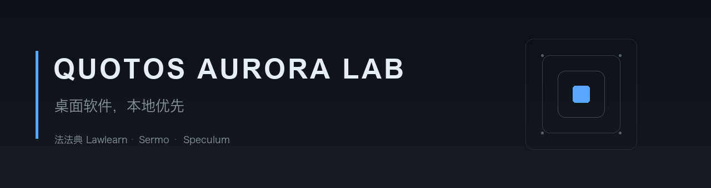

  

  
  
  
  

---

## 产品

<table>
<tr>
<td width="33%" valign="top">

### 法法典 Lawlearn

离线法条库配上 AI 解释。法律文本按四卷组织，62 份司法解释共 2835 条，解释与法条之间的引用关系逐条人工校对。

没网也能查条文、看章节；接上自己的 API 可以做白话解释与案件分析。

`macOS 14+` · `Windows 7+` · `Android 8+`

[下载](https://github.com/QuotOS-Aurora-Lab/Lawlearn_Download)

</td>
<td width="33%" valign="top">

### Sermo

QuotOS Aether 的独立 macOS 客户端。把对话界面单独拿出来，配上自己的设置面板，打开就能用。

纯 Swift + WebKit，无第三方依赖，产物 5.1 MB。支持七家服务商。

`macOS 14+`

[下载](https://github.com/QuotOS-Aurora-Lab/Sermo_Download) · [源码](https://github.com/QuotOS-Aurora-Lab/Sermo)

</td>
<td width="33%" valign="top">

### Speculum

把视频链接粘进来，下载下来。macOS 原生应用，安装包自带 yt-dlp 与 ffmpeg。

新的 Mac 上不需要额外装任何东西。

`macOS 14+`

[下载](https://github.com/QuotOS-Aurora-Lab/QuotOS_Speculum_Download)

</td>
</tr>
</table>

---

## 技术

| 平台 | 技术栈 |
| --- | --- |
| macOS | Swift · SwiftUI · AppKit |
| Windows | Python · PySide2（Qt 5.15）；4.0.0 起 PySide6 |
| Android | Kotlin |
| AI 接入 | OpenAI 兼容接口，七家服务商自动识别 |

---

## 说明

这些软件**不含任何 API 密钥**。对话与解释走你填的密钥，密钥、对话记录、收藏与笔记都存在本机，不上传。

法条与司法解释来自公开渠道，条文以官方发布为准。
